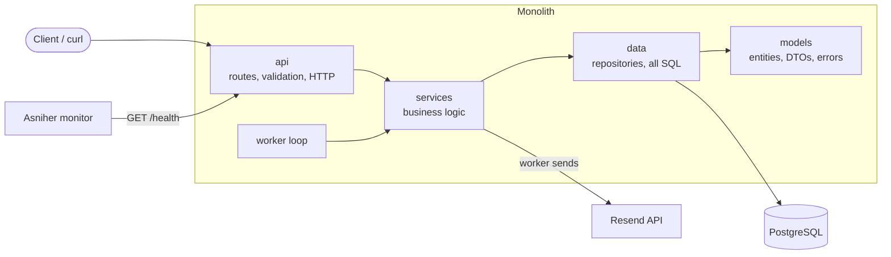

# Job Tracker API

A monolithic backend for tracking job applications. Built with **Node.js + Express**, **PostgreSQL**, an **email queue powered by Resend**, and a `/health` endpoint monitored on **Asniher**.

When you create an application or change its status, the endpoint **does not send an email**. It stores an `email_jobs` row in the same DB transaction, and a **background worker** delivers it through Resend with retries.

## Web interface

Open the root URL (`http://localhost:3000/` or your deployed URL) for a browser UI: a board with one column per stage, drag-and-drop status changes, search, add/edit/delete, and the email queue counts. It is a static page in `public/` served by the same Express app and talks to the REST API below, so there is nothing extra to deploy.

## Architecture



| Layer | Folder | Responsibility | May call |
|---|---|---|---|
| api | `src/api` | Routes, request validation, HTTP status codes | services, models |
| services | `src/services` | Business rules, transactions, email templates, Resend client | data, models |
| data | `src/data` | Repositories, migrations runner, seed, **all SQL** | models |
| models | `src/models` | Entities/DTO mappers, constants, domain errors | nothing |

`src/worker` is the background loop; it only calls services. Rules are enforced by a script: `npm run check:layers`.

### Email queue flow

1. `POST /applications` saves the application **and** an `email_jobs` row (`pending`) in one transaction.
2. The worker claims a due job (`FOR UPDATE SKIP LOCKED`, plus a lock timeout so a crashed worker never blocks a job) and sends it via Resend.
3. Success → `sent`. Failure → attempt counted, job stays `pending` with exponential backoff (30s, 60s, 120s by default).
4. After the first attempt plus **3 retries** (4 attempts) it becomes `failed` and `last_error` is kept.

## Setup

Requirements: Node 18+, PostgreSQL 13+.

```bash
git clone <your-repo-url> && cd job-tracker-api
npm install
cp .env.example .env        # then fill in DATABASE_URL and RESEND_API_KEY
createdb job_tracker        # or use any Postgres instance
npm run migrate             # create tables
npm run seed                # optional sample data
npm run dev                 # http://localhost:3000
```

`npm start` runs migrations and then the server (used in production).

### Environment variables

| Variable | Required | Default | Description |
|---|---|---|---|
| `DATABASE_URL` | yes | - | PostgreSQL connection string |
| `DATABASE_SSL` | no | `false` | `true` for managed DBs that need SSL |
| `RESEND_API_KEY` | yes | - | Resend API key |
| `EMAIL_FROM` | no | `Job Tracker <onboarding@resend.dev>` | Sender. Sandbox sender only delivers to your own Resend email; verify a domain to email anyone |
| `PORT` | no | `3000` | HTTP port |
| `RUN_WORKER` | no | `true` | Run the worker inside the API process. `false` + `npm run worker` for a separate process |
| `WORKER_POLL_MS` | no | `2000` | Queue poll interval |
| `EMAIL_MAX_RETRIES` | no | `3` | Retries after the first failure |
| `EMAIL_RETRY_BASE_SECONDS` | no | `30` | Backoff base (`base * 2^attempt`) |

## API

Application statuses: `wishlist`, `applied`, `interviewing`, `offer`, `rejected`, `withdrawn`.

| Method | Path | Description |
|---|---|---|
| GET | `/health` | App + database status (200 / 503) |
| POST | `/applications` | Create (queues a confirmation email if `notifyEmail` is set) |
| GET | `/applications?status=&search=&limit=&offset=` | List with filters and pagination |
| GET | `/applications/:id` | Get one |
| PATCH | `/applications/:id` | Update (a status change queues an email) |
| DELETE | `/applications/:id` | Delete |
| GET | `/emails?status=pending\|sent\|failed` | List queue jobs |
| GET | `/emails/stats` | Counts per status |
| GET | `/emails/:id` | One job incl. body and last error |

### Example requests

```bash
# Health
curl -i http://localhost:3000/health

# Create an application (queues an email)
curl -X POST http://localhost:3000/applications \
  -H "Content-Type: application/json" \
  -d '{"company":"Stripe","position":"Backend Engineer","status":"applied","url":"https://stripe.com/jobs","notifyEmail":"you@example.com"}'

# List, filtered
curl "http://localhost:3000/applications?status=applied&search=stripe"

# Move it to interviewing (queues a status-change email)
curl -X PATCH http://localhost:3000/applications/<id> \
  -H "Content-Type: application/json" \
  -d '{"status":"interviewing","notes":"Phone screen on Friday"}'

# Watch the queue
curl http://localhost:3000/emails/stats
curl "http://localhost:3000/emails?status=failed"

# Delete
curl -X DELETE http://localhost:3000/applications/<id>
```

Example `/health` response:

```json
{
  "status": "ok",
  "app": { "status": "up", "uptimeSeconds": 842 },
  "database": { "status": "up", "latencyMs": 3 },
  "timestamp": "2026-11-03T18:00:00.000Z"
}
```
When the database is unreachable the status code is `503` and `database.status` is `"down"`.

## Deployment and monitoring

Example with [Render](https://render.com) (any host works):

1. Create a **PostgreSQL** instance and copy its *Internal Database URL*.
2. Create a **Web Service** from this repo: build `npm install`, start `npm start`.
3. Set the env vars above (`DATABASE_URL`, `DATABASE_SSL=true`, `RESEND_API_KEY`, `EMAIL_FROM`).
4. In [Asniher](https://asniher.com/), add an HTTP monitor for `https://<your-app>/health`, expecting status `200`, with a 1-5 minute interval.
5. Add a screenshot of the monitor to `docs/asniher-monitor.png` and reference it here:


## Project structure

```
public/            browser UI (single static page)
migrations/        SQL migrations (run by npm run migrate)
scripts/           check-layers.js (architecture rule checker)
src/
  api/             routes, validators, error handler
  services/        business logic, email templates, Resend mailer
  data/            db pool, repositories, migrate, seed
  models/          entities, DTO mappers, domain errors
  worker/          background email worker
  app.js server.js config.js
```
